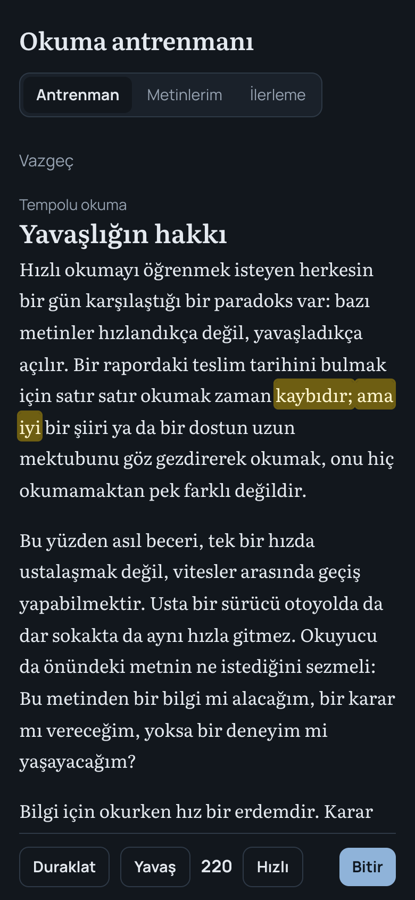
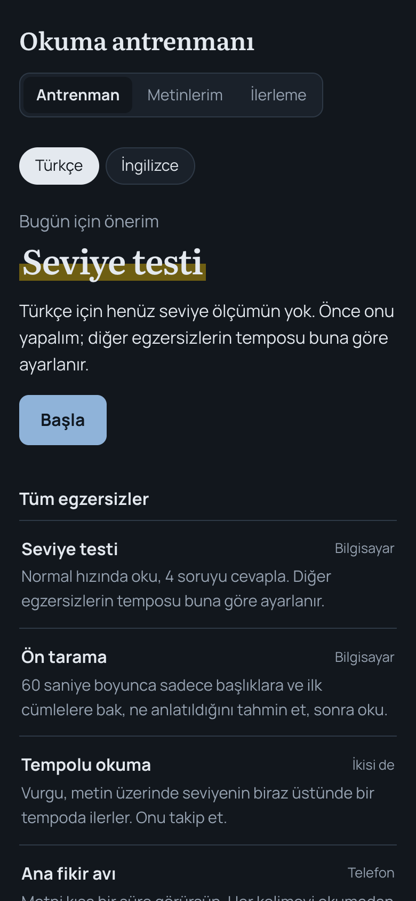
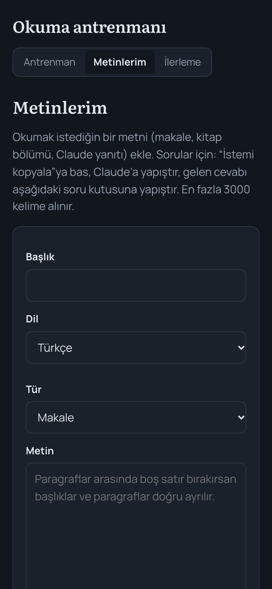

# Okuma antrenmanı — reading trainer

A small, phone-first app for practising reading speed **and** comprehension, in Turkish and English. It measures your level first, then sets the pace of every other exercise from that measurement, and tracks words per minute together with how much you understood.



---

## The problem

Most speed-reading tools push a single number up: words per minute. Reading faster while understanding less is not progress. And most of them work only in English, with texts nobody chose.

This app treats speed and understanding as one score, adapts to the reader's own level per language, and lets the reader practise on the texts they actually need to read.

## What it does

- **Level test.** Read a text at your normal pace and answer four questions. The result sets the starting pace for the other exercises, separately for Turkish and English.
- **Seven exercises,** each marked for phone or computer:
  - *Level test*
  - *Preview*: 60 seconds on headings and first sentences, guess the content, then read.
  - *Paced reading*: a highlight moves through the text slightly above your level, and the pace can be changed while reading.
  - *Main-idea hunt*: the text is shown briefly; catch the main idea without reading every word.
  - *Information hunt*: see the question first, then find the answer as fast as possible.
  - *First-sentence reading*: read only the first sentence of each paragraph and guess the main idea.
  - *Summarise*: read, summarise in two sentences without looking, then compare with the main idea.
- **"Park it first."** Before an exercise the app offers a box for whatever is on your mind; it is shown back to you at the end.
- **Built-in texts.** About two dozen short texts in Turkish and English (reports, essays, explainers). They are fictional and were written for this app.
- **My texts.** Paste your own text (an article, a book chapter, an AI answer) up to 3,000 words. For comprehension questions, the app gives a prompt to copy into Claude and a box to paste the questions back. The app itself makes no AI calls.
- **Progress.** Words per minute, comprehension score and a combined score per session and per language.
- **Backup.** Export / import progress as a file or via the clipboard, to move between devices.

## Tech

| Area | What is used |
|---|---|
| App | One HTML file: vanilla JavaScript, HTML and CSS, no framework and no build step |
| Offline and install | Web app manifest and a small service worker (`sw.js`) |
| Data | Browser `localStorage`. No accounts, no backend, no analytics. |
| Fonts | Literata and Manrope from Google Fonts (the only outside request) |
| Hosting | Vercel (static) |

## Status

A working personal tool, used by the author. No automated tests yet.

## How it was built

Built with Claude. The author defined the exercises and the reading method, wrote the requirements, tested on phone and computer, and made the product decisions.

## Screenshots

| Home | Paced reading | My texts |
|---|---|---|
|  |  |  |

## Run locally

No install needed:

```bash
python3 -m http.server 8000
```

Then open http://localhost:8000.

---

© 2026 Elif Köslü. The code is shared for portfolio review; all rights reserved.
